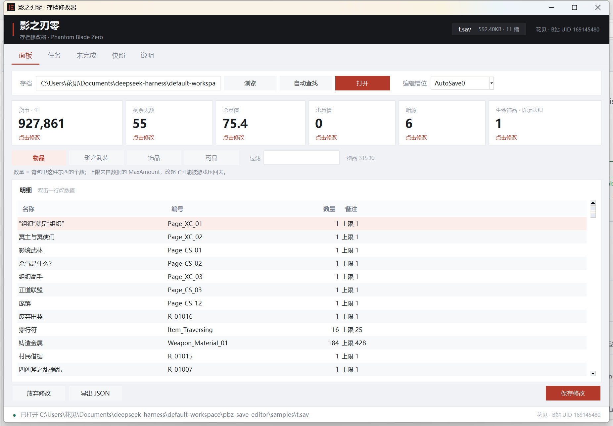
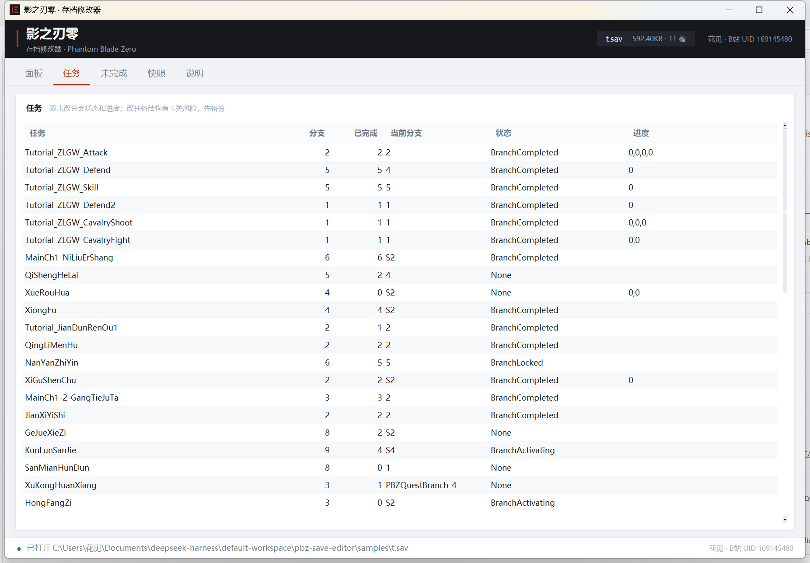

# 影之刃零 · 存档修改器

打开存档，自动读出货币、天数、杀意、物品（带中文名）、任务，点着改，写回去。

**作者：花见 · B站 UID 169145480**




## 用法

双击 `dist/PBZSaveTool.exe`（单文件），或解压 `dist/PBZSaveTool-folder.zip` 用文件夹版。

1. 打开存档。点「自动查找」会扫 `...\Saved\SaveGames\Steam\<SteamID>\PBZSaveGame.sav`。
2. 面板顶部六张卡：**货币·尘 / 剩余天数 / 杀意值 / 杀意槽 / 暗源 / 生命饰品（珍玩妖织）**，点卡改值。
3. 明细按类别列：**物品 / 影之武装 / 饰品 / 药品**，中文名 + 内部编号，双击改数值，过滤框支持中文。
4. 「任务」页 51 条，**双击可改分支状态和进度**。
5. 「未完成」页：30 条没走完的任务 + 45 个没拿到的饰品。
6. 改完「保存修改」→ 自动备份 `.bak-时间戳`。

编辑槽位在右上角，默认 `AutoSave0`。游戏读哪档就改哪档。

界面按系统 DPI 缩放（系统级 DPI 感知），150% 缩放下不会发虚。

## 各栏数值是什么

| 栏 | 数值含义 |
| --- | --- |
| 物品 | 背包数量。上限来自 `MaxAmount`，改超了可能被游戏压回去 |
| 影之武装 | 武器等级，和面板显示一致 |
| 饰品 | **强化等级**：0 = 已获得未强化，1 = 已强化；备注里标「已装备 / 未装备」 |
| 药品 | 强化等级；备注里是「当前次数 / 上限」 |
| 生命饰品等级 | `AC_Health` 的强化等级。**当前生命值不在存档里**，是运行时状态 |

## 暗源（SpiritShadow）是什么

`Player.SpiritShadow` 官方中文是**暗源**，它和复活系统一起存档（`renewalplayer.js` 里紧跟着「前三次复活」的字段）。实测：进度 61 天时是 **4**，55 天时是 **6**，随进度涨，不是剩余复活次数。

面板上标成「**暗源**」，只建议查看。要改的话小心中招：值被游戏侧校验的概率不低。

## 刷取未获得的饰品

「未完成」页下半部分列出目录里有、存档里没有的饰品：

1. 选中一行，点「添加到存档」，或直接双击
2. 会写进 `Inventory.AccessoryInfos`（强化等级 0、`AcquiredCycle` 0）
3. 回到「面板 → 饰品」能看到它，再点「保存修改」写回文件

这是整条记录追加，不是改数值。游戏若有校验，可能出现「有图标但装备不上」，改前先备份。

## 任务修改

任务页双击任意一行，弹窗里可以改：

- **分支**：下拉选 `BranchID`
- **状态**：`BranchCompleted` / `BranchActivating` / `BranchLocked` / `None`
- **进度**：`TasksProgress` 数组，写成 `0,0,0`
- 或直接点「标记该分支完成」

改任务有卡关风险，先记原值、留好 `.bak`。任务页的「未完成」会实时反映改动。

## 中文名从哪来

`names.json`（844 条 id → 中文名）是从本机游戏资源导出的，流程：

1. 用 pak 密钥解 `ProjectPBZ-Windows.pak`（5585 个文件），取 `game.locres` 中文文本表。
2. 读 `ProjectPBZ-Windows.utoc/.ucas`（IoStore，304,988 个文件），取 `DT_InventoryData` / `DT_WeaponData` / `DT_ShaqiWeaponData` / `DT_Accessory` / `DT_MedicineTable` 等数据表。
3. 把数据表里的 FText 键和 locres 对上，得到 id → 名称。

例：`BrutalAxe` → 巨凶斧，`ShachiHook` → 追命锁镰，`AC_Health` → 珍玩妖织，`Item_Traversing` → 穿行符。

重新生成（游戏更新后）：

```
python tools/build_names.py      # 需要本机装有游戏
```

## 读的是什么字段

| 面板项 | JSON 路径 |
| --- | --- |
| 货币（尘） | `Player.Dust` |
| 剩余天数 | `Player.RemainingDays` |
| 杀意值 | `Player.UltimateCharge`（0–100 浮点） |
| 杀意槽 | `Player.UltimateChargeCount` |
| 暗源 | `Player.SpiritShadow` |
| 生命饰品等级 | `Inventory.AccessoryInfos.AC_Health.CurrentLevel` |
| 物品数量 | `Inventory.InventoryInfos.<ID>.CurrentAmount` |
| 影之武装等级 | `Inventory.ShaChiWeaponInfo.<ID>.ShaChiWeaponLevel` |
| 饰品等级 | `Inventory.AccessoryInfos.<ID>.CurrentLevel` |
| 药品次数 | `Inventory.MedicineInfos.<ID>.CurrentLevel` |

**生命值本身没存进存档**（运行时状态），面板给的是生命饰品等级；改血量要用内存修改器。

## 如果 Windows 提示「对计算机有害」

这是 SmartScreen 对**未签名 exe** 的信誉提示，不是真检测到病毒。三种处理，任选：

1. **先解锁压缩包再解压**：右键 `PBZSaveTool-folder.zip` → 属性 → 勾选「解除锁定」→ 确定，然后解压。解出来的文件不带「来自 Internet」标记，双击不再弹。
2. **已经解压的**：右键 `PBZSaveTool.exe` → 属性 → 勾选「解除锁定」→ 确定。
3. **弹窗里直接放行**：点「更多信息」→「仍要运行」。

如果被 Defender 真的隔离了，把文件夹加进「病毒和威胁防护 → 排除项」，或者用源码跑：

```
python pbz_editor.py
```

彻底不弹的办法只有代码签名证书（EV 证书可即时建立信誉），这个得你自己签。

## 报「Could not create temporary directory」

单文件版启动时要把自己解压到临时目录，这一步被拦就会弹这句（`%TEMP%` 不可写、杀软拦截、清理软件改过临时目录权限都可能）。

按顺序试：

1. **用文件夹版**：`PBZSaveTool-folder.zip`，解压后直接双击里面的 exe。文件夹版没有解包这一步，永远不会报这个错。
2. **单文件版放到可写目录**：挪到桌面或文档，双击同目录的 `启动.bat`（它把 `TMP`/`TEMP` 指到同级的 `tmp`）。新版 exe 已改成解包到 exe 旁边，不再碰系统临时目录。
3. **杀软排除**：把 exe 所在文件夹加进「病毒和威胁防护 → 排除项」再试。

真单文件又完全不落盘，PyInstaller / Nuitka / 7z 自解压都做不到，只能选文件夹版。

## 格式

```
文件头   PBZS + 03 01 + u16 槽数 + u32 目录长
目录块   seal(文件头 + 条目表)          # 明文前 12 字节必须等于文件头
条目     u16 名长 + 名 + 02 01 + u32 明文长 + u32 偏移 + u32 块长
数据块   "PBZS 01 01 00 00" + nonce(12) + tag(16) + AES-256-GCM 密文
压缩     算法 2 = Oodle，解出来是 JSON
```

写回用 Oodle 存储块（`CC 06` + 原始数据，256KB 一段）：格式合法、无需专有编码器，代价是文件变大。未改动的槽位保持原密文块。

## 命令行

```
PBZSaveTool.exe list 存档
PBZSaveTool.exe find 存档 927861
PBZSaveTool.exe get  存档 AutoSave0 Player.Dust
PBZSaveTool.exe set  存档 AutoSave0 Player.Dust 999999
```

## 文件

```
pbz_save.py      容器 / AES-GCM / Oodle / JSON 编辑 / 重新打包
pbz_editor.py    GUI + 命令行
names.json       844 条 id → 中文名
native/          pbz_codec.dll（Oodle 解码器）
refpak/          读 pak / IoStore / 数据表 / locres 的模块
tools/           打包、导出名称、分析脚本
samples/         实测存档副本
```

重打包：

```
python tools/getpkg.py pyinstaller pyinstaller-hooks-contrib altgraph packaging pefile pywin32-ctypes setuptools pycryptodome pillow cryptography
$env:PYTHONPATH = ".\vendor"
python -m PyInstaller --onefile --windowed --name PBZSaveTool --add-data "native;native" --add-data "names.json;." --paths ".\vendor" pbz_editor.py
```

## 注意

- 退出游戏、关掉 Steam 云同步再写，否则可能被云存档覆盖。
- 只改数值，别动结构；改坏了用 `.bak` 还原。
- 写回是存储块，文件会变大，属正常。

## 致谢与许可

- 容器格式、Oodle 存储块、pak / IoStore / locres 解析参考 [qry6868/PBZ-Editor](https://github.com/qry6868/PBZ-Editor)（MIT）。
- Oodle 解码器 `pbz_codec.dll` 来自 [oozextract](https://github.com/WorkingRobot/oozextract)（MIT），见 `native/oozextract-NOTICE.md`。
- AES 密钥与 pak 密钥由使用者/参考项目提供。

## 许可

- 本项目代码：MIT，见 [LICENSE](LICENSE)。
- 第三方组件与游戏数据来源：见 [NOTICE.md](NOTICE.md)。
- `refpak/` 目录取自 [PBZ-Editor](https://github.com/qry6868/PBZ-Editor)（MIT），许可证全文在其目录下。
- `native/pbz_codec.dll` 来自 [oozextract](https://github.com/WorkingRobot/oozextract)（MIT）。

## 免责声明

单机存档工具，与 S-Game 及《影之刃零》开发团队无关。
仅用于本地单机存档的查看与修改，请勿用于联机、排行榜或任何反作弊场景。
修改前请自行备份，使用风险自负。

## 发布

第一次发布到 GitHub 的完整步骤见 [docs/发布步骤.md](docs/发布步骤.md)。
